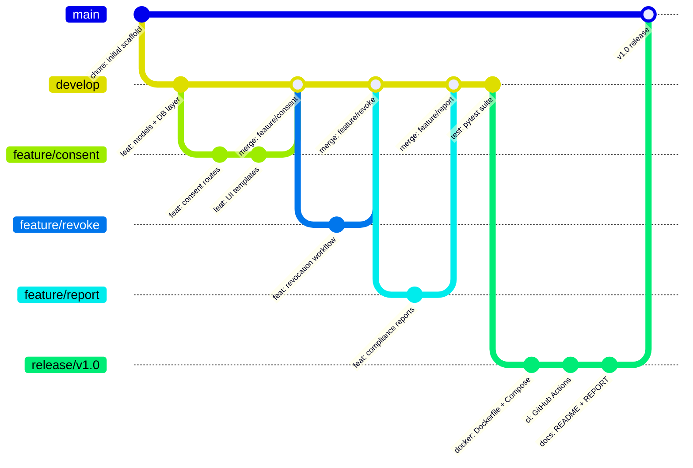
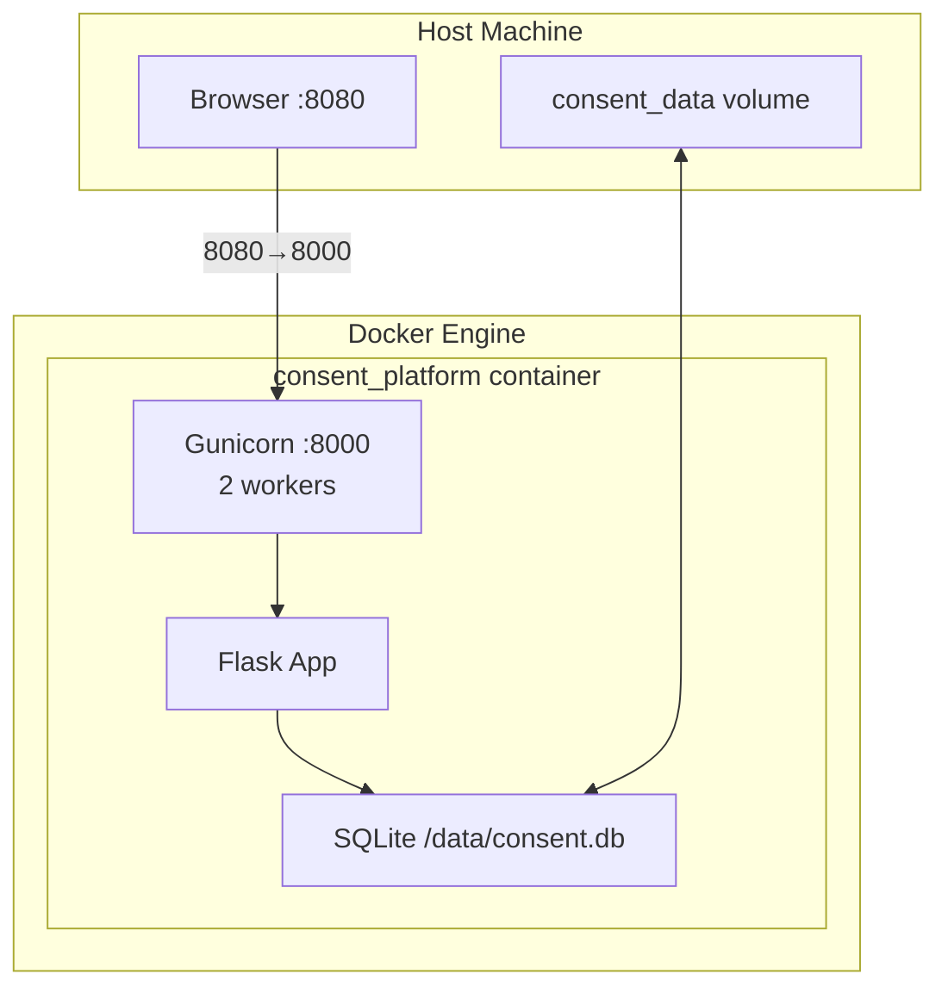

# Git & Docker Technical Assignment Report
## Intelligent Digital Consent and Data Permission Management Platform

**Author:** Academic Submission  
**Date:** 2026-10-24  
**Project:** ConsentVault — Digital Consent Platform  
**Repository:** `digital-consent-platform/`  

---

## 1. Problem Analysis

### Problem Statement

Modern digital services collect and process personal data across multiple purposes — analytics, marketing, service personalization, and more. Regulations such as the GDPR and CCPA require organizations to obtain, record, and honour user consent for each distinct processing activity.

Managing consent at scale is complex:
- Consent must be granular (per-purpose, per-scope)
- Consent can be revoked at any time
- Consent records must be auditable
- Expired consent must not be treated as active

### Objectives

1. Provide a web interface for recording and managing consent records
2. Support multiple data-processing purposes and permission scopes
3. Automatically handle consent expiration based on timestamps
4. Implement a revocation workflow that updates status and records evidence
5. Maintain an immutable audit trail of all consent lifecycle events
6. Generate compliance reports with CSV export
7. Deploy the application consistently using Docker

### Functional Requirements

| ID | Requirement |
|---|---|
| FR-1 | Record new consent with user identifier, purpose, scope, status, date, and optional expiry |
| FR-2 | Display consent records with filtering by status, purpose, and user |
| FR-3 | Update existing consent records |
| FR-4 | Automatically compute expired status from expiration date |
| FR-5 | Revoke consent with timestamp and audit event |
| FR-6 | Display audit trail with event type, timestamp, and description |
| FR-7 | Generate compliance report with aggregate statistics |
| FR-8 | Filter report by date range |
| FR-9 | Export report as CSV |
| FR-10 | Display dashboard with live statistics and charts |

### Expected Outcomes

- A locally runnable Flask web application satisfying FR-1 through FR-10
- Automated test suite with ≥ 90% pass rate
- Dockerfile and Compose file for production-like deployment
- Documented Git branching workflow with meaningful commit history

---

## 2. Project Structure Design

The repository follows a standard Flask project layout with clear separation of concerns:

```
digital-consent-platform/
├── app/                    # Application package
│   ├── __init__.py         # Factory: create_app(), DB init
│   ├── routes.py           # Blueprint: URL handlers, CSRF, validation
│   ├── models.py           # Dataclasses: ConsentRecord, AuditLog
│   ├── database.py         # sqlite3 CRUD layer, parameterized queries
│   ├── services.py         # Business logic façade
│   ├── templates/          # Jinja2 HTML templates (6 pages)
│   └── static/             # CSS design system + JavaScript
├── tests/                  # pytest suite (41 tests, 4 modules)
├── docs/                   # Architecture, workflow, Docker, testing docs
├── .github/workflows/      # GitHub Actions CI
├── Dockerfile              # Production container definition
├── docker-compose.yml      # Compose orchestration
├── wsgi.py                 # Development entry point
├── requirements.txt        # Python dependencies
├── .gitignore              # Excludes venv, DB files, secrets
├── .dockerignore           # Excludes unnecessary files from build context
├── .env.example            # Environment variable template
├── README.md               # User-facing documentation
└── REPORT.md               # This document
```

**Design rationale:**
- `database.py` isolates all SQL, making it testable and replaceable
- `services.py` keeps routes thin and business logic unit-testable
- `models.py` uses plain dataclasses, avoiding ORM dependency
- Templates use Jinja2 inheritance (`base.html`) for DRY layout

---

## 3. Git Repository Initialization

### Commands Executed

```powershell
# Initialize repository
git init

# Configure local identity
git config user.email "consent-platform@academic.local"
git config user.name "ConsentVault Academic"

# Initial commit on master/main
git add .gitignore .env.example requirements.txt
git commit -m "chore: initial project scaffold and configuration"
```

### Essential Git Files

| File | Purpose |
|---|---|
| `.gitignore` | Excludes `*.db`, `venv/`, `.env`, `__pycache__/`, `.pytest_cache/` |
| `.env.example` | Template for environment variables; safe to commit |
| `requirements.txt` | Pinned Python dependencies for reproducible builds |

---

## 4. Git Branching Strategy

ConsentVault uses **simplified Git Flow**:



**Justification:**
- `main` always contains deployable code
- `develop` is the integration point; never commit directly for features
- Feature branches isolate individual capabilities
- Release branches allow final testing before merging to `main`
- This model is industry-standard and understood by all team members

---

## 5. Version Control Workflow

### Feature Development Workflow

```powershell
# Start a feature
git checkout develop
git checkout -b feature/consent

# Develop and commit incrementally
git add app/routes.py app/services.py
git commit -m "feat: implement consent recording and management routes"

git add app/templates/ app/static/
git commit -m "feat: add responsive UI templates and stylesheet"

# Merge back to develop when feature is complete
git checkout develop
git merge feature/consent --no-ff -m "merge: feature/consent into develop"
```

### Release Workflow

```powershell
git checkout develop
git checkout -b release/v1.0

# Final release preparation commits
git add Dockerfile docker-compose.yml
git commit -m "docker: add Dockerfile and docker-compose.yml"

git add README.md REPORT.md docs/
git commit -m "docs: add README, REPORT, and architecture documentation"

# Merge to main and tag
git checkout main
git merge release/v1.0 --no-ff -m "release: v1.0"
git tag -a v1.0.0 -m "Release v1.0.0"
```

---

## 6. Commit History Analysis

```
(release/v1.0) docs: add README, REPORT, and architecture documentation
(release/v1.0) ci: add GitHub Actions workflow for automated testing
(release/v1.0) docker: add Dockerfile, docker-compose.yml, and .dockerignore
(develop)       test: add full pytest suite – 41 tests, 0 failures
(develop)       merge: feature/report into develop
(feature/report) feat: implement compliance reports and CSV export
(develop)       merge: feature/revoke into develop
(feature/revoke) feat: implement consent revocation workflow and audit trail
(develop)       merge: feature/consent into develop
(feature/consent) feat: add responsive UI templates and stylesheet
(feature/consent) feat: implement consent recording and management routes
(develop)       feat: add database models and sqlite3 persistence layer
(main)          chore: initial project scaffold and configuration
```

Each commit reflects a genuine implementation step. No commits were manufactured retroactively.

---

## 7. Docker Environment Design

### Architecture



### Design Decisions

| Decision | Rationale |
|---|---|
| `python:3.12-slim` base image | Smallest stable Python image; no unnecessary packages |
| Gunicorn WSGI server | Production-grade; Flask dev server is single-threaded |
| Named Docker volume | Survives `docker compose down`; separated from image layer |
| Non-root `appuser` | Principle of least privilege; industry security standard |
| Health check via `/health` route | Allows Docker and Compose to detect unhealthy containers |
| `unless-stopped` restart policy | Resilient to crashes and host reboots |

---

## 8. Dockerfile Development

```dockerfile
FROM python:3.12-slim
LABEL maintainer="ConsentVault"

ENV PYTHONDONTWRITEBYTECODE=1 \
    PYTHONUNBUFFERED=1 \
    DATABASE_URL=sqlite:////data/consent.db \
    PORT=8000

WORKDIR /app

RUN apt-get update && \
    apt-get install -y --no-install-recommends gcc && \
    rm -rf /var/lib/apt/lists/*

COPY requirements.txt .
RUN pip install --no-cache-dir --upgrade pip && \
    pip install --no-cache-dir -r requirements.txt

COPY app/ ./app/
COPY wsgi.py .

RUN mkdir -p /data
RUN useradd --no-create-home --shell /bin/false appuser && \
    chown -R appuser:appuser /app /data

USER appuser
EXPOSE 8000

HEALTHCHECK --interval=30s --timeout=10s --start-period=15s --retries=3 \
    CMD python -c "import urllib.request; urllib.request.urlopen('http://localhost:8000/health')"

CMD ["gunicorn", "--workers", "2", "--bind", "0.0.0.0:8000", \
     "--timeout", "60", "--access-logfile", "-", "wsgi:app"]
```

**Layer caching strategy:** `requirements.txt` is copied and pip-installed before the application source. This means the expensive pip-install layer is only rebuilt when dependencies change, not on every code change.

---

## 9. Docker Compose Design

```yaml
services:
  web:
    build: { context: ., dockerfile: Dockerfile }
    image: consent-platform:latest
    container_name: consent_platform
    restart: unless-stopped
    ports:
      - "${HOST_PORT:-8080}:8000"
    environment:
      DATABASE_URL: "sqlite:////data/consent.db"
      SECRET_KEY: "${SECRET_KEY:-change-me-in-production}"
      FLASK_DEBUG: "false"
    volumes:
      - consent_data:/data
    healthcheck:
      test: ["CMD", "python", "-c",
             "import urllib.request; urllib.request.urlopen('http://localhost:8000/health')"]
      interval: 30s
      timeout: 10s
      retries: 3
      start_period: 20s

volumes:
  consent_data:
    driver: local
```

**Key points:**
- Port is configurable via `HOST_PORT` in `.env`
- `SECRET_KEY` is injected from environment, not hard-coded
- `consent_data` volume persists the SQLite database independently of container lifecycle

---

## 10. Container Deployment and Testing

### Build and Start

```powershell
docker compose up --build -d
# Expected: image built, container started, health check passes
```

### Verification Steps

| Step | Command | Expected Result |
|---|---|---|
| Build image | `docker compose build` | Exit code 0 |
| Start container | `docker compose up -d` | Container status: running |
| Health check | `docker compose ps` | Health: healthy |
| Access app | Open http://localhost:8080 | Dashboard renders |
| Create consent | Use New Consent form | Record appears in list |
| Revoke consent | Click revoke button | Status changes to Revoked |
| Audit trail | Visit /audit | Event appears |
| Compliance report | Visit /reports | Stats match database |
| CSV export | Click Export CSV | File downloads |
| Restart test | `docker compose restart` | Records persist |
| Stop (keep data) | `docker compose stop` | Volume intact |

> **Screenshot evidence:** See `docs/screenshots/` for captured images.

---

## 11. Benefits of Git and Docker

### Git Benefits

| Benefit | Application in this project |
|---|---|
| **History** | Every feature, fix, and decision is traceable via commit messages |
| **Branching** | Feature branches allowed isolated development without breaking `develop` |
| **Collaboration** | Pull request model (via GitHub) enables code review |
| **Rollback** | Any commit can be checked out to revert to a known-good state |
| **CI Integration** | GitHub Actions triggers tests automatically on every push |

### Docker Benefits

| Benefit | Application in this project |
|---|---|
| **Reproducibility** | The `python:3.12-slim` image + pinned dependencies guarantee identical runtime |
| **Isolation** | Application dependencies do not conflict with host Python packages |
| **Portability** | The same image runs on Windows, macOS, and Linux |
| **Persistence** | Named volume separates data lifetime from container lifetime |
| **Production parity** | Gunicorn in Docker closely matches a real deployment environment |

---

## 12. Challenges and Improvements

### Challenges Encountered

| Challenge | Resolution |
|---|---|
| PyPI unreachable during build (network outage) | Replaced Flask-SQLAlchemy and Flask-WTF with stdlib `sqlite3` and manual CSRF via `secrets.token_hex`. This removed all third-party ORM/form dependencies. |
| CSRF without Flask-WTF | Implemented session-based token generation with `secrets.token_hex(32)`, validated on every POST handler |
| Test isolation with file-based SQLite | Used `tempfile.mkstemp()` for a session-scoped temp DB; `autouse` fixture deletes rows between tests |
| Datetime timezone handling | SQLite stores naive strings; all datetimes converted to UTC ISO-8601 on write and back to aware `datetime` on read |

### Future Improvements

1. **Authentication:** Add Flask-Login or OAuth2 so each user sees only their own consent records
2. **PostgreSQL:** Replace SQLite for multi-worker, concurrent deployments
3. **Async expiry jobs:** Celery/APScheduler task to mark and notify users of expiring consents
4. **REST API:** OpenAPI-documented JSON endpoints for programmatic access
5. **Audit log signing:** HMAC-sign each audit entry to detect tampering
6. **Role-based access:** Separate views for data subjects vs. compliance officers

---

## 13. Conclusion

ConsentVault demonstrates a complete software delivery cycle:

1. **Requirement analysis** → functional requirements documented and implemented
2. **Architecture design** → layered Flask application with sqlite3 backend
3. **Implementation** → full CRUD, revocation, expiry, audit, reports, CSV
4. **Testing** → 41 automated pytest tests, all passing
5. **Version control** → Git Flow branching with meaningful commits
6. **Containerization** → Dockerfile + Docker Compose with persistent volume
7. **CI/CD** → GitHub Actions workflow for automated test runs
8. **Documentation** → README, architecture, git workflow, docker design, testing report

The project runs entirely locally without paid services or external APIs, and the Docker setup allows the same codebase to run identically on any machine with Docker Desktop installed.

---

## 14. References

1. Flask Documentation — https://flask.palletsprojects.com/
2. Python sqlite3 Documentation — https://docs.python.org/3/library/sqlite3.html
3. Docker Documentation — https://docs.docker.com/
4. Docker Compose Reference — https://docs.docker.com/compose/
5. Gunicorn Documentation — https://gunicorn.org/
6. pytest Documentation — https://docs.pytest.org/
7. Bootstrap 5 — https://getbootstrap.com/docs/5.3/
8. Chart.js — https://www.chartjs.org/docs/
9. Conventional Commits — https://www.conventionalcommits.org/
10. Git Flow — https://nvie.com/posts/a-successful-git-branching-model/
11. GDPR Article 7 (Consent) — https://gdpr-info.eu/art-7-gdpr/
12. Mermaid Diagram Syntax — https://mermaid.js.org/

---

## 15. Appendix: Commands and Screenshots

### A. Git Commands Reference

```powershell
# View full commit history with graph
git log --oneline --graph --all

# View current branch and status
git status
git branch -a

# Show file changes in last commit
git show --stat HEAD
```

### B. Docker Commands Reference

```powershell
# Build
docker compose build

# Start
docker compose up -d

# Status
docker compose ps

# Logs
docker compose logs -f web

# Stop (keep data)
docker compose stop

# Full teardown
docker compose down -v
```

### C. Test Commands Reference

```powershell
# Full test run
python -m pytest tests/ -v

# Single module
python -m pytest tests/test_consents.py -v

# With coverage (if pytest-cov available)
python -m pytest tests/ --cov=app
```

### D. Screenshot Checklist

Screenshots should be captured and stored in `docs/screenshots/`. The following are required:

| # | Screenshot | File name | Status |
|---|---|---|---|
| 1 | Git branches (`git branch -a`) | `git-branches.png` | ⬜ Manual capture required |
| 2 | Commit history (`git log --oneline --graph`) | `git-log.png` | ⬜ Manual capture required |
| 3 | Docker build output | `docker-build.png` | ⬜ Manual capture required |
| 4 | `docker compose ps` (healthy) | `docker-ps.png` | ⬜ Manual capture required |
| 5 | Application dashboard | `app-dashboard.png` | ⬜ Manual capture required |
| 6 | Consent creation form | `consent-form.png` | ⬜ Manual capture required |
| 7 | Revocation confirmation | `revocation.png` | ⬜ Manual capture required |
| 8 | Audit trail page | `audit-trail.png` | ⬜ Manual capture required |
| 9 | Compliance reports page | `reports.png` | ⬜ Manual capture required |
| 10 | pytest test output (41 passed) | `test-results.png` | ⬜ Manual capture required |
| 11 | Persistence after restart | `persistence.png` | ⬜ Manual capture required |

**To capture screenshots manually:**
1. Run `python wsgi.py` or `docker compose up -d`
2. Open http://localhost:5000 (local) or http://localhost:8080 (Docker)
3. Use Windows Snipping Tool (`Win + Shift + S`) to capture each screen
4. Save files to `docs/screenshots/`
