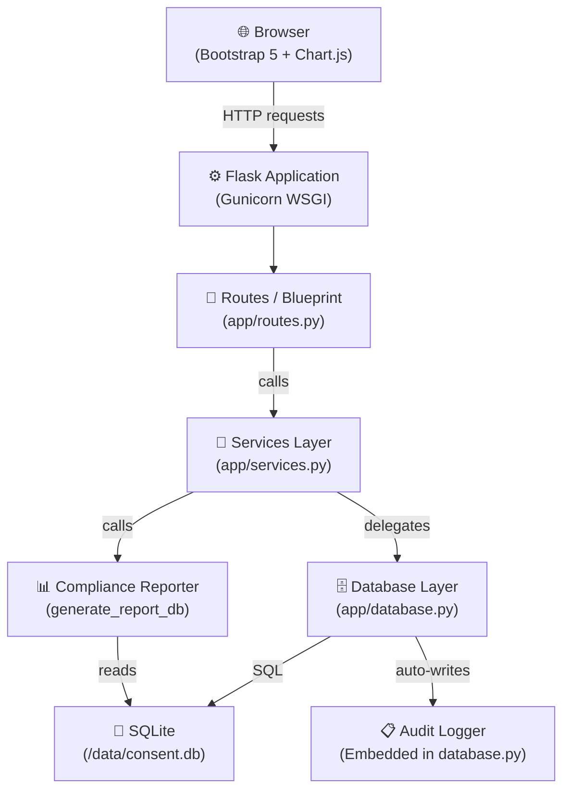

# System Architecture

## Overview

ConsentVault follows a layered Flask application architecture with clear separation of concerns between routing, business logic, and data access.

## Architecture Diagram



## Layer Descriptions

| Layer | File | Responsibility |
|---|---|---|
| Presentation | `templates/*.html` + `static/` | HTML rendering, CSS, Chart.js charts |
| Routing | `app/routes.py` | URL dispatch, form parsing, flash messages, CSRF |
| Services | `app/services.py` | Business logic façade, public API for routes |
| Data Access | `app/database.py` | Raw `sqlite3` CRUD, parameterized queries, row mapping |
| Models | `app/models.py` | Python dataclasses (`ConsentRecord`, `AuditLog`) |
| Storage | SQLite file | Persistent relational storage |

## Database Schema

```
consent_records
├── id               INTEGER PK AUTOINCREMENT
├── user_identifier  TEXT NOT NULL
├── purpose          TEXT NOT NULL
├── scope            TEXT NOT NULL
├── status           TEXT NOT NULL  (granted|denied|revoked|expired)
├── consent_date     TEXT NOT NULL  (ISO-8601 UTC)
├── expiration_date  TEXT           (ISO-8601 UTC, nullable)
├── revocation_date  TEXT           (ISO-8601 UTC, nullable)
├── notes            TEXT
├── created_at       TEXT NOT NULL
└── updated_at       TEXT NOT NULL

audit_logs
├── id          INTEGER PK AUTOINCREMENT
├── consent_id  INTEGER FK → consent_records.id (nullable)
├── event_type  TEXT NOT NULL
├── description TEXT NOT NULL
└── timestamp   TEXT NOT NULL  (ISO-8601 UTC)
```

## Security Design

- **CSRF:** Session-based token generated with `secrets.token_hex(32)`, validated on every POST
- **SQL Injection:** All queries use parameterized placeholders (`?`)
- **Secrets:** `SECRET_KEY` read from environment variable; `.env` excluded from Git
- **Stack traces:** Custom error handlers return plain error pages
- **Non-root Docker user:** Container runs as `appuser`

## Data Flow: Consent Creation

```
User submits form
  → POST /consents/new
    → _validate_csrf()
    → _validate_consent_form()
    → services.create_consent()
      → database.insert_consent()
        → INSERT INTO consent_records
        → INSERT INTO audit_logs (consent_created)
    → flash success
    → redirect /consents
```
