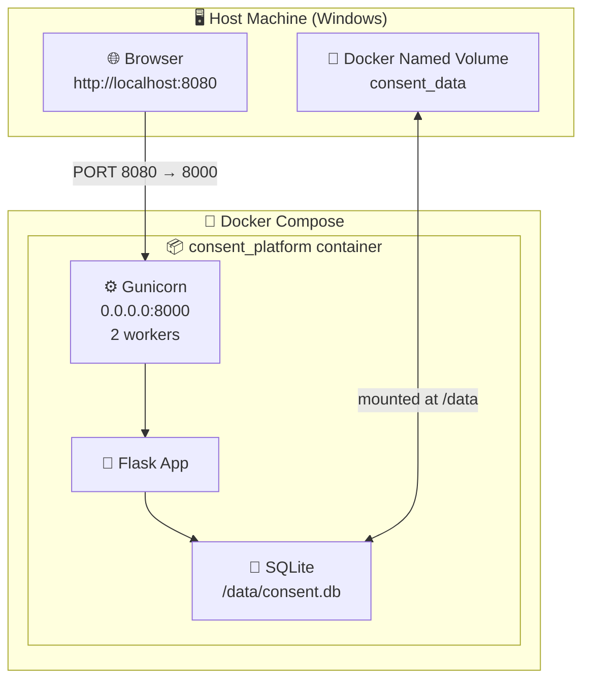

# Docker Design Documentation

## Container Architecture



## Dockerfile Design Decisions

| Decision | Choice | Reason |
|---|---|---|
| Base image | `python:3.12-slim` | Minimal attack surface; no unnecessary OS packages |
| Working directory | `/app` | Clear, conventional location |
| Layer caching | `COPY requirements.txt` before `COPY app/` | `pip install` layer only rebuilds when dependencies change |
| WSGI server | Gunicorn (2 workers) | Production-grade; Flask dev server is single-threaded and not suitable |
| Non-root user | `appuser` | Principle of least privilege |
| Unbuffered output | `PYTHONUNBUFFERED=1` | Log lines appear immediately in `docker logs` |
| Data directory | `/data` created in image | Volume mount target exists before container starts |
| Health check | HTTP GET `/health` via `urllib.request` | No additional tools needed; uses Python stdlib |

## Docker Compose Design Decisions

| Decision | Choice | Reason |
|---|---|---|
| Build context | Local `Dockerfile` | No registry dependency; works fully offline |
| Port mapping | `${HOST_PORT:-8080}:8000` | Configurable via `.env`; default 8080 avoids conflicts |
| Volume | Named volume `consent_data` | Data persists across `docker compose down`; survives image rebuilds |
| Restart policy | `unless-stopped` | Auto-restarts on crash or host reboot; stops cleanly on manual stop |
| Credentials | Via `.env` file | Secrets never in `docker-compose.yml` |
| External DB | None required | SQLite is self-contained; no PostgreSQL/MySQL service needed |

## Container Lifecycle Commands

```powershell
# Build image
docker compose build

# Start (build + detach)
docker compose up --build -d

# Check status and health
docker compose ps

# View logs
docker compose logs -f web

# Execute a command inside the running container
docker compose exec web python -c "print('alive')"

# Stop (containers removed, volume kept)
docker compose down

# Stop and DELETE the database volume
docker compose down -v

# Rebuild after code changes
docker compose up --build -d

# Pull latest base image
docker compose pull
```

## Volume Persistence Verification

```powershell
# 1. Start the application and create a consent record via the browser
docker compose up -d

# 2. Stop the container
docker compose stop

# 3. Start again
docker compose start

# 4. Open http://localhost:8080 — the record should still be present
# The SQLite file lives in the Docker volume, not in the container layer.
```

## Image Layers (build order)

```
FROM python:3.12-slim          ← base OS + Python interpreter
RUN apt-get install gcc        ← C compiler (for compiled wheels)
COPY requirements.txt .        ← dependency manifest
RUN pip install -r ...         ← installed packages (cached layer)
COPY app/ wsgi.py              ← application source
RUN mkdir /data                ← data directory
RUN useradd appuser            ← non-root user
USER appuser                   ← drop privileges
CMD gunicorn ...               ← entrypoint
```
