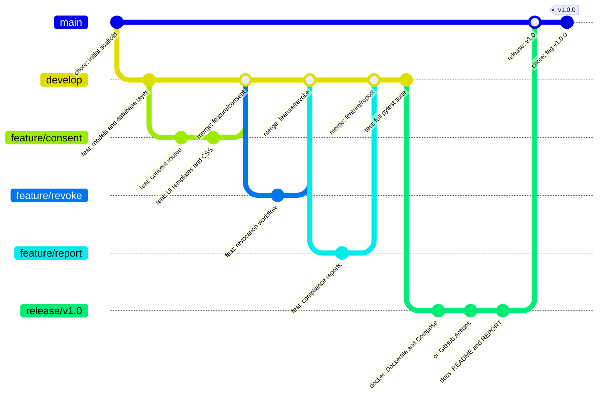

# Git Workflow Documentation

## Branching Strategy

ConsentVault follows a simplified **Git Flow** model suitable for academic and small-team projects.

## Branch Diagram



## Branch Roles

| Branch | Purpose | Created From | Merges Into |
|---|---|---|---|
| `main` | Stable, production-ready | — | — |
| `develop` | Integration and daily work | `main` | `main` via release |
| `feature/consent` | Consent CRUD and UI | `develop` | `develop` |
| `feature/revoke` | Revocation workflow | `develop` | `develop` |
| `feature/report` | Compliance reporting | `develop` | `develop` |
| `release/v1.0` | Release preparation | `develop` | `main` |
| `hotfix/*` | Urgent production fixes | `main` | `main` + `develop` |

## Commit Conventions

Commits use **Conventional Commits** prefixes:

| Prefix | Meaning |
|---|---|
| `feat:` | New feature or capability |
| `fix:` | Bug fix |
| `test:` | Test additions or changes |
| `docs:` | Documentation only |
| `docker:` | Dockerfile or Compose changes |
| `ci:` | CI/CD pipeline changes |
| `chore:` | Scaffolding, config, maintenance |
| `merge:` | Merge commit message |

## Essential Git Commands Used

```powershell
# Initialize repository
git init

# Set identity (local to this repo)
git config user.email "consent-platform@academic.local"
git config user.name "ConsentVault Academic"

# Stage and commit
git add <files>
git commit -m "feat: implement consent recording"

# Create and switch to a new branch
git checkout -b feature/consent

# Merge a feature branch back to develop
git checkout develop
git merge feature/consent --no-ff -m "merge: feature/consent into develop"

# View commit history
git log --oneline --graph --all

# View current status
git status

# Connect to GitHub (after creating the remote repo)
git remote add origin https://github.com/<username>/digital-consent-platform.git
git push -u origin main
```

## GitHub Synchronization

No remote is configured in this repository. To publish to GitHub:

1. Create a new **empty** repository at https://github.com/new
2. Run the following in PowerShell:

```powershell
cd "c:\Permission Management Platform\digital-consent-platform"
git remote add origin https://github.com/<YOUR_USERNAME>/digital-consent-platform.git
git push -u origin main
git push origin develop
git push origin release/v1.0
```

> **Note:** GitHub authentication is required. Use a Personal Access Token (PAT) or GitHub CLI (`gh auth login`).
